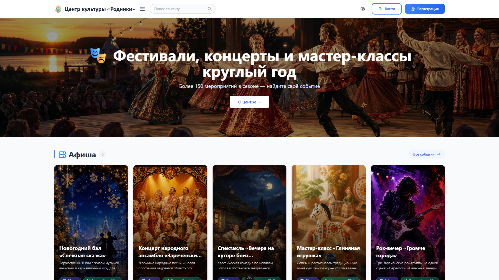
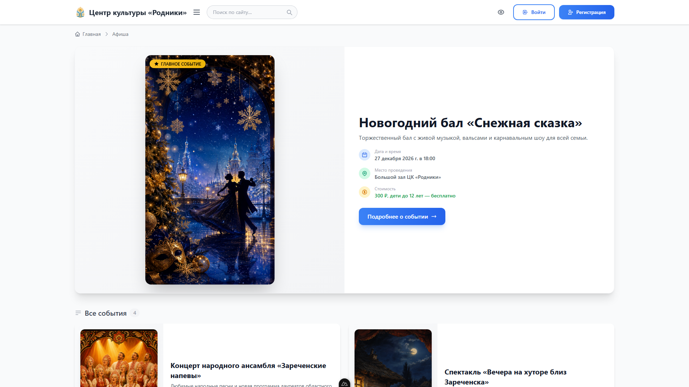
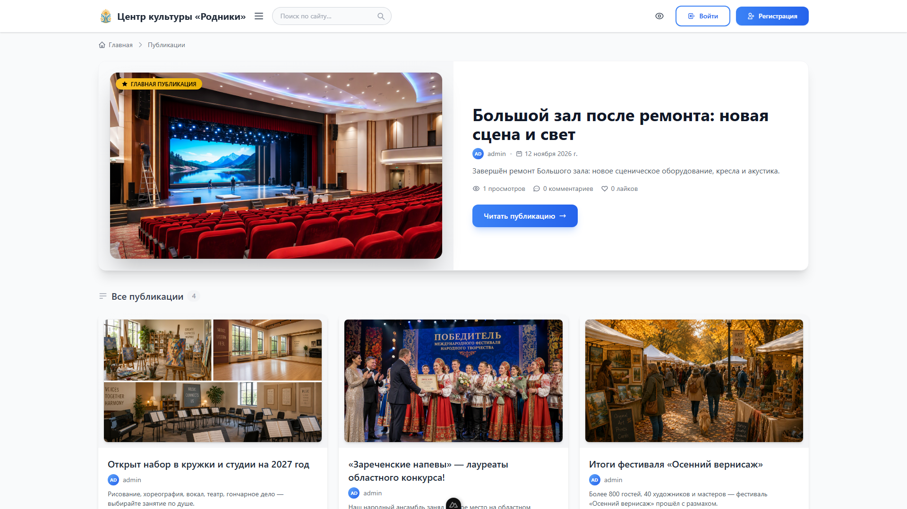
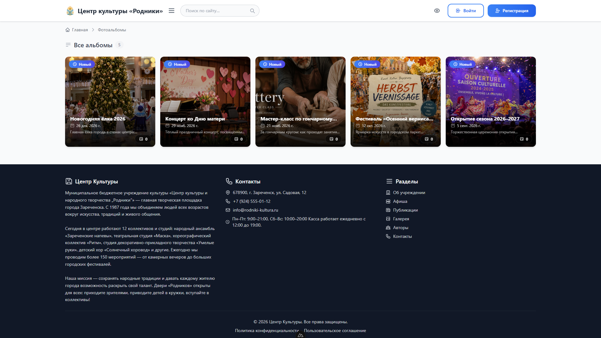
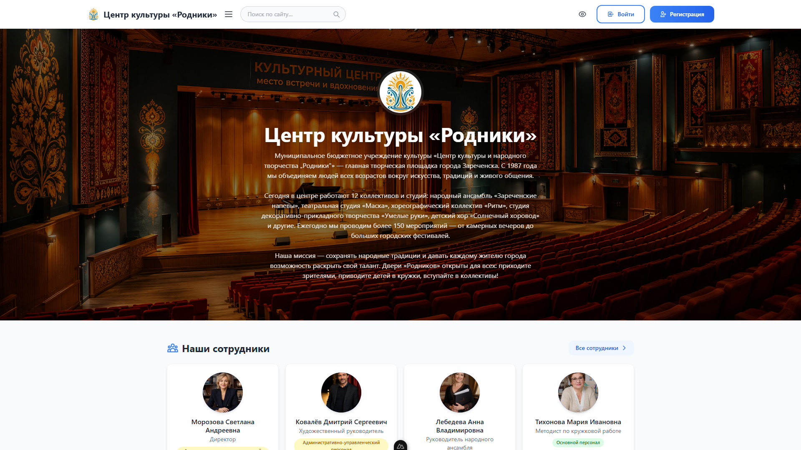
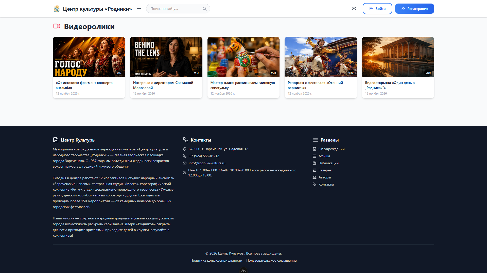
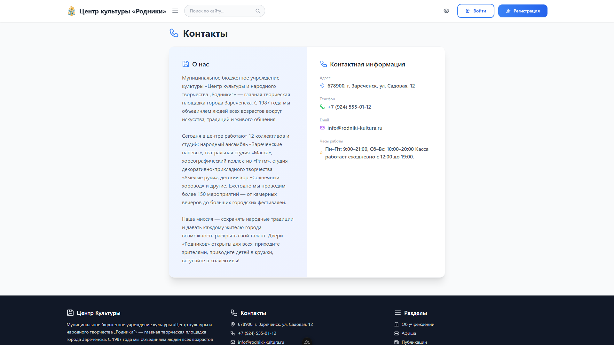

# 🏛️ Центр Культуры — веб-платформа для учреждения культуры

Полнофункциональный веб-сайт муниципального центра культуры: афиша событий, новости, фотогалерея, медиатека, личные кабинеты и система ролей. Проект разработан как готовое решение для ДК, домов культуры и творческих коллективов.



## ✨ Возможности

**Для посетителей**
- 📅 Афиша событий с главным событием, датами, местами и ценами
- 📰 Публикации (новости) с обложками, просмотрами, лайками и комментариями
- 🖼️ Фотогалерея с альбомами, лайками и комментариями к фото
- 🎬 Медиатека: видеоролики (плеер с перемоткой, Range-запросы) и аудиодорожки
- 🏛️ Страница «Об учреждении»: описание, сотрудники, клубные формирования, достижения, официальные документы
- 🔔 Личный кабинет: регистрация, профиль с аватаром и соцсетями, подписки на авторов, уведомления
- 🔍 Поиск по сайту, опросы и тесты в публикациях, тёмная тема оформления

**Для редакции (роли: автор / главный редактор)**
- ✍️ Публикация и редактирование постов, событий, альбомов, видео и аудио через интерфейс сайта
- 🎨 Управление hero-баннером главной страницы (фон, тексты, кнопка)
- 👥 Административная панель Django для полного управления контентом

## 🛠️ Технологический стек

| Слой | Технологии |
|------|-----------|
| **Фронтенд** | Nuxt 4, Vue 3, Pinia, Tailwind CSS, GSAP |
| **Бэкенд** | Django 6, Django REST Framework, SimpleJWT |
| **База данных** | SQLite (легко мигрирует на PostgreSQL) |
| **Авторизация** | JWT-токены (access/refresh), сессии Django для админки |
| **Медиа** | Pillow, потоковая отдача видео/аудио с поддержкой Range |

## 📸 Скриншоты

| Афиша | Публикации |
|-------|-----------|
|  |  |

| Галерея | Об учреждении |
|---------|---------------|
|  |  |

| Видеотека | Контакты |
|-----------|----------|
|  |  |

## 🚀 Быстрый старт

### Требования
- Python 3.12+
- Node.js 20+

### Бэкенд

```bash
cd backend
python -m venv venv

# Windows:
venv\Scripts\activate
# Linux/macOS:
source venv/bin/activate

pip install -r requirements.txt
python manage.py migrate
python manage.py createsuperuser   # создайте администратора
python manage.py runserver         # http://127.0.0.1:8000
```

### Фронтенд (в отдельном терминале)

```bash
cd frontend
npm install
npm run dev                        # http://localhost:3000
```

Фронтенд обращается к API бэкенда по адресу `http://127.0.0.1:8000/api` (настраивается в `frontend/nuxt.config.ts`).

## 🗂️ Структура проекта

```
kultcentr/
├── backend/                # Django + DRF API
│   ├── config/             # Настройки, маршруты, раздача медиа (Range)
│   ├── users/              # Пользователи, роли, подписки, JWT
│   ├── posts/              # Публикации, опросы, тесты
│   ├── events/             # Афиша событий
│   ├── gallery/            # Фотоальбомы, лайки, комментарии
│   ├── medialib/           # Видео- и аудиотека
│   ├── about/              # Учреждение, сотрудники, клубы, достижения, документы
│   ├── banner/             # Hero-баннер главной
│   ├── comments/ likes/    # Комментарии и лайки
│   ├── notifications/      # Уведомления
│   ├── feedback/           # Обратная связь
│   └── contactinfo/        # Контактная информация
└── frontend/               # Nuxt 4 SPA
    ├── pages/              # Страницы (афиша, посты, галерея, медиа, профиль…)
    ├── components/         # UI-компоненты
    ├── store/              # Pinia-хранилища (auth, theme)
    └── composables/        # API-клиент и хелперы
```

## 👥 Роли пользователей

| Роль | Возможности |
|------|-------------|
| **Подписчик** | Комментарии, лайки, подписки, личный кабинет |
| **Автор** | + публикация собственных постов |
| **Главный редактор** | + редактирование всего контента, управление баннером |

## 🗺️ Планы по развитию

- Мелкие правки мобильной вёрстки (до 320px)
- Улучшение счётчика уведомлений (обновление без перезагрузки)
- Доработка видеоплеера и всплывающий аудиоплеер
- Права на соавторство для редакторов

## 💼 О проекте

Коммерческий продукт: платформа разворачивается «под ключ» для учреждений культуры — домов культуры, центров народного творчества, театров и творческих коллективов. В услугу входят установка, настройка, наполнение контентом и обучение редакции.

По вопросам приобретения и внедрения — через раздел «Issues» этого репозитория или контакты в профиле автора.

---

*Демо-контент (название учреждения, персоны, события, контакты) вымышлен и создан для демонстрации возможностей платформы.*
